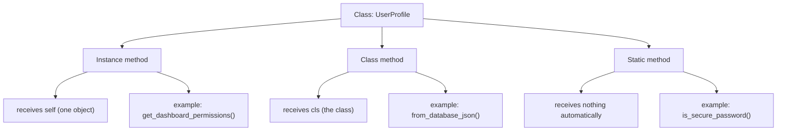
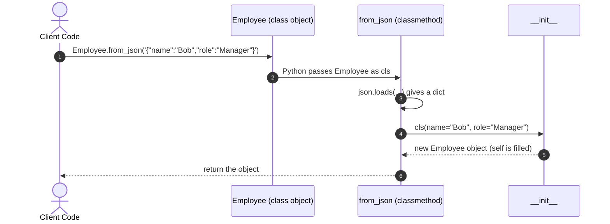
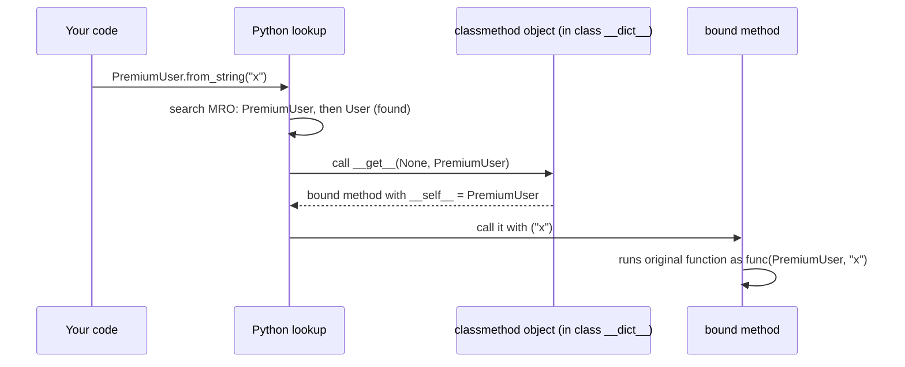
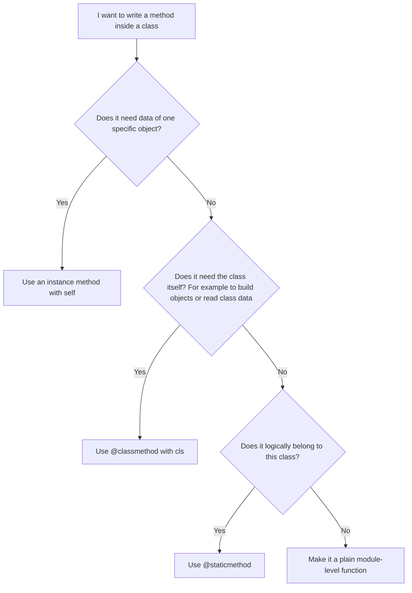

# Python `@classmethod`: Complete Interview-Ready Notes

> Goal of these notes: understand `@classmethod` fully, from "what is it" to "how does Python do it internally", and be able to answer any interview question on it.
>
> Built from your two files (`classmethod.md` and `decoratorMethods.py`), then extended with the missing topics, corrections, interview questions, and practice problems.

---

## Table of Contents

1. [The Big Picture: Three Kinds of Methods](#1-the-big-picture-three-kinds-of-methods)
2. [What Is `@classmethod`?](#2-what-is-classmethod)
3. [Why Do We Need It? (The Problem It Solves)](#3-why-do-we-need-it-the-problem-it-solves)
4. [Alternative Constructor and Factory Method](#4-alternative-constructor-and-factory-method)
5. [`cls` and Inheritance (The Most Important Idea)](#5-cls-and-inheritance-the-most-important-idea)
6. [Factory Pattern and LLD (Low Level Design)](#6-factory-pattern-and-lld-low-level-design)
7. [Using `@classmethod` for Class-Level State](#7-using-classmethod-for-class-level-state)
8. [Under the Hood: How Python Really Does It](#8-under-the-hood-how-python-really-does-it)
9. [`@classmethod` vs `@staticmethod` vs Instance Method (Deep Comparison)](#9-classmethod-vs-staticmethod-vs-instance-method-deep-comparison)
10. [`@property` (From Your File, Explained Fully)](#10-property-from-your-file-explained-fully)
11. [Real Patterns You Will See in Production](#11-real-patterns-you-will-see-in-production)
12. [Common Mistakes and Pitfalls](#12-common-mistakes-and-pitfalls)
13. [Corrections and Improvements to Your Original Notes](#13-corrections-and-improvements-to-your-original-notes)
14. [Interview Questions and Model Answers](#14-interview-questions-and-model-answers)
15. [Coding Exercises With Solutions](#15-coding-exercises-with-solutions)
16. [One-Page Cheat Sheet](#16-one-page-cheat-sheet)
17. [Final Checklist: Do You Understand It Fully?](#17-final-checklist-do-you-understand-it-fully)

---

# 1. The Big Picture: Three Kinds of Methods

Before learning `@classmethod`, you must see where it sits among the other method types. A class in Python can contain three kinds of methods.

## 1.1 The three kinds in one view

| Kind            | Decorator         | First parameter       | Can read/change instance data? | Can read/change class data?                       | Typical job                                                  |
| --------------- | ----------------- | --------------------- | ------------------------------ | ------------------------------------------------- | ------------------------------------------------------------ |
| Instance method | none              | `self` (the object) | Yes                            | Yes (through`self.__class__` or `type(self)`) | Work on one specific object                                  |
| Class method    | `@classmethod`  | `cls` (the class)   | No (there is no object)        | Yes                                               | Create objects, work on class-wide data                      |
| Static method   | `@staticmethod` | nothing special       | No                             | No                                                | Helper function that lives inside the class for organisation |

## 1.2 Simple way to remember

- **Instance method** asks: "Which object are you working on?" Answer: `self`.
- **Class method** asks: "Which class are you working on?" Answer: `cls`.
- **Static method** asks nothing. It is a normal function placed inside a class.

## 1.3 Diagram



## 1.4 Your example file in one glance

From `decoratorMethods.py`, the `UserProfile` class:

```python
import json

class UserProfile:
    COMPANY_DOMAIN = "techcorp.com"        # class variable (shared by all)

    def __init__(self, username, email, role):
        self.username = username           # instance variables (one per object)
        self.email = email
        self.role = role

    # 1. Instance method: needs one specific user
    def get_dashboard_permissions(self):
        if self.role == "Admin":
            return f"ACCESS GRANTED: {self.username} has full system controls."
        return f"ACCESS RESTRICTED: {self.username} has standard read-only view."

    # 2. Class method: builds a new user from raw JSON
    @classmethod
    def from_database_json(cls, json_string):
        data = json.loads(json_string)
        generated_email = f"{data['user']}@{cls.COMPANY_DOMAIN}"
        return cls(username=data["user"], email=generated_email, role=data["role"])

    # 3. Static method: pure helper, needs neither self nor cls
    @staticmethod
    def is_secure_password(password):
        return len(password) >= 8
```

Notice how the class method uses **`cls.COMPANY_DOMAIN`** (class data) and **`cls(...)`** (to build an object). The instance method uses **`self.role`**. The static method uses only its own argument.

---

# 2. What Is `@classmethod`?

## 2.1 Definition (say this in an interview)

> `@classmethod` is a built-in decorator that turns a method into one that receives the **class itself** (not the instance) as its first argument. By convention that argument is named `cls`.

## 2.2 Basic syntax

```python
class MyClass:
    @classmethod
    def my_method(cls, other_args):
        # cls is MyClass here (or a subclass, if called through a subclass)
        ...
```

## 2.3 Key facts about the syntax

1. `cls` is only a **naming convention**, like `self`. Python does not force the name, but everyone uses `cls`. Never use anything else in real code.
2. You do **not** pass `cls` yourself. Python passes it automatically.
3. The decorator line `@classmethod` must be directly above the `def`.
4. Because `class` is a reserved keyword in Python, we write `cls` instead.

## 2.4 Two ways to call it

```python
class Demo:
    @classmethod
    def who(cls):
        return cls.__name__

print(Demo.who())      # Call through the class  -> 'Demo'   (most common, preferred)
d = Demo()
print(d.who())         # Call through an object  -> 'Demo'   (works, but confusing)
```

When you call through an object, Python still passes the **class of that object**, not the object. So inside the method you can never reach `d`'s instance data.

## 2.5 What `cls` really is

`cls` is a normal variable that holds a **class object**. In Python, classes are also objects. Because of this, you can:

- call it: `cls(...)` creates a new instance
- read its attributes: `cls.COMPANY_DOMAIN`
- read its name: `cls.__name__`
- inspect inheritance: `cls.__mro__`

```python
class User:
    @classmethod
    def info(cls):
        print(cls)                 # <class '__main__.User'>
        print(cls.__name__)        # User
        print(type(cls))           # <class 'type'>   (a class is an instance of type)
```

---

# 3. Why Do We Need It? (The Problem It Solves)

## 3.1 Problem 1: `__init__` accepts only one shape of data

```python
class User:
    def __init__(self, first_name, last_name):
        self.first_name = first_name
        self.last_name = last_name

user = User("Jane", "Doe")        # works
```

But real data arrives in many shapes: a JSON string, a dictionary, `"Jane Doe"` as one string, a database row, a CSV line, a timestamp. `__init__` cannot handle all of these directly.

## 3.2 Problem 2: Python has no method overloading

In Java or C++ you can write many constructors with different parameter lists. In Python, the **last definition wins**:

```python
class User:
    def __init__(self, first, last):
        ...

    def __init__(self, full_string):     # this REPLACES the one above
        ...

User("Jane", "Doe")   # TypeError: __init__() takes 2 positional arguments but 3 were given
```

So Python needs another way to offer "multiple constructors". That way is `@classmethod`.

## 3.3 Problem 3: Hiding messy parsing from the caller

Without a factory, every caller must do the parsing work itself. That duplicates code everywhere (see Section 6.3 for the full before and after example).

## 3.4 Solution summary

| Problem                 | How`@classmethod` solves it                            |
| ----------------------- | -------------------------------------------------------- |
| One`__init__` only    | You can write unlimited named classmethod constructors   |
| Different input formats | Each classmethod accepts one format and converts it      |
| Duplicate parsing code  | Parsing lives in one place, inside the class             |
| Subclass support        | `cls` automatically adapts to the subclass (Section 5) |

## 3.5 Why not just use a normal function outside the class?

You could write `def user_from_json(s): return User(...)`. It works, but:

- It hardcodes `User`, so subclasses cannot reuse it correctly.
- It is separated from the class, so it is harder to discover (`User.` + autocomplete shows classmethods, but not random module functions).
- It does not follow Python's standard naming convention (`from_*`).

---

# 4. Alternative Constructor and Factory Method

## 4.1 Standard constructor

The standard constructor is `__init__`. It is the **front door**. It needs one specific kind of ID (arguments).

## 4.2 Alternative constructor

An **alternative constructor** is a classmethod that gives a **side door**. It accepts other kinds of input, converts them, and then goes through the front door by calling `cls(...)`.

> Important: an alternative constructor does **not** replace `__init__`. It prepares data and then calls `__init__` through `cls(...)`.

## 4.3 Why "factory method"?

A factory takes raw material and returns a finished product. A factory method takes raw input (JSON, string, file) and returns a finished object. The caller does not need to know how the object is built.

## 4.4 Step-by-step flow



## 4.5 Complete example

```python
import json

class Employee:
    # Standard constructor
    def __init__(self, name: str, role: str):
        self.name = name
        self.role = role

    # Alternative constructor 1: from JSON text
    @classmethod
    def from_json(cls, json_string: str):
        data = json.loads(json_string)
        return cls(name=data["name"], role=data["role"])

    # Alternative constructor 2: from "Name-Role" text
    @classmethod
    def from_string(cls, text: str):
        name, role = text.split("-")
        return cls(name.strip(), role.strip())

    # Alternative constructor 3: from a dictionary
    @classmethod
    def from_dict(cls, data: dict):
        return cls(data["name"], data["role"])


emp1 = Employee("Alice", "Developer")                               # front door
emp2 = Employee.from_json('{"name": "Bob", "role": "Manager"}')     # side door 1
emp3 = Employee.from_string("Carol - Designer")                     # side door 2
emp4 = Employee.from_dict({"name": "Dan", "role": "Tester"})        # side door 3
```

## 4.6 Naming convention (interviewers notice this)

| Style                        | Meaning                    | Example                                                  |
| ---------------------------- | -------------------------- | -------------------------------------------------------- |
| `from_<source>`            | Build from a source format | `from_json`, `from_dict`, `from_csv`, `from_env` |
| `of(...)`, `create(...)` | Generic creator            | `Money.of(10, "USD")`                                  |
| noun/preset name             | A ready-made preset        | `Pizza.margherita()`, `Color.red()`                  |
| `today()`, `now()`       | Build from current state   | `date.today()`                                         |

## 4.7 Presets (from your file)

A classmethod can also build common ready-made objects with no input at all:

```python
class Pizza:
    def __init__(self, ingredients: list):
        self.ingredients = ingredients

    @classmethod
    def margherita(cls):
        return cls(["mozzarella", "tomatoes", "basil"])

    @classmethod
    def meat_lovers(cls):
        return cls(["mozzarella", "pepperoni", "bacon", "ham"])

my_lunch = Pizza.margherita()
print(my_lunch.ingredients)       # ['mozzarella', 'tomatoes', 'basil']
```

## 4.8 Built-in Python examples you already use

| Standard constructor      | Alternative constructor (classmethod)                                              |
| ------------------------- | ---------------------------------------------------------------------------------- |
| `date(2026, 10, 8)`     | `date.today()`, `date.fromisoformat("2026-10-08")`, `date.fromtimestamp(ts)` |
| `dict(a=1)`             | `dict.fromkeys(["a", "b"], 0)`                                                   |
| `int("10")`             | `int.from_bytes(b"\x01\x00", "big")`                                             |
| `bytes([65, 66])`       | `bytes.fromhex("4142")`                                                          |
| `Path("/tmp")`          | `Path.cwd()`, `Path.home()`                                                    |
| `datetime(2026, 10, 8)` | `datetime.now()`, `datetime.fromisoformat(...)`, `datetime.strptime(...)`    |

In an interview, naming `datetime.fromisoformat` or `dict.fromkeys` shows you understand this is a real standard-library idiom.

---

# 5. `cls` and Inheritance (The Most Important Idea)

This is the **number one interview topic** about classmethod. If you only remember one section, remember this one.

## 5.1 The rule

> When you call a classmethod, `cls` is the class **on the left side of the dot**, not the class where the method was written.

```python
class User:
    def __init__(self, name):
        self.name = name

    @classmethod
    def from_string(cls, s):
        return cls(s)

class PremiumUser(User):
    def show_badge(self):
        return "Premium Member"

u = User.from_string("Alice")             # cls is User
p = PremiumUser.from_string("Bob")        # cls is PremiumUser (even though the method is written in User)

print(type(u).__name__)     # User
print(type(p).__name__)     # PremiumUser
print(p.show_badge())       # Premium Member
```

## 5.2 Diagram of what happens


## 5.3 What breaks with `@staticmethod` (from your file)

```python
class User:
    def __init__(self, name):
        self.name = name

    @staticmethod
    def from_string(data_string):
        return User(data_string)        # hardcoded class name

class PremiumUser(User):
    def show_badge(self):
        return "Premium Member"

obj = PremiumUser.from_string("Alice")
print(type(obj).__name__)     # User   <-- wrong, we wanted PremiumUser
obj.show_badge()              # AttributeError: 'User' object has no attribute 'show_badge'
```

The factory returned a parent object because the class name was written directly in the code. With `@classmethod` and `cls(...)`, the problem disappears.

## 5.4 Proof using `id()` (from your file, explained)

```python
class User:
    @classmethod
    def factory(cls, name):
        print(cls.__name__, id(cls))
        return cls()

class AdminUser(User):
    pass

print(id(User), id(AdminUser))     # two different numbers
User.factory("A")                  # prints User and the same id as User
AdminUser.factory("B")             # prints AdminUser and the same id as AdminUser
```

This proves `cls` is literally the same object as the class that was called. The actual numbers change on every run. Do not memorise any specific numbers.

## 5.5 Inside the class dictionary

Even when called through the subclass, the function code lives only once, in the parent:

```python
print("from_string" in User.__dict__)          # True
print("from_string" in PremiumUser.__dict__)   # False (it is inherited, not copied)
```

Python looks for the name along the MRO (Method Resolution Order), finds it in `User`, and then binds `cls` to the class you started the lookup from (`PremiumUser`).

## 5.6 Subclass constructor signature warning

`cls(...)` calls the **subclass's** `__init__`. If the subclass changes the `__init__` parameters, the inherited factory may break:

```python
class Q:
    def __init__(self, a):
        self.a = a

    @classmethod
    def build(cls, a):
        return cls(a)

class R(Q):
    def __init__(self, a, b):
        super().__init__(a)
        self.b = b

R.build(1)
# TypeError: R.__init__() missing 1 required positional argument: 'b'
```

Fixes:

- Keep subclass `__init__` signatures compatible with the parent (this is the Liskov Substitution Principle).
- Or override the classmethod in the subclass.
- Or accept `*args, **kwargs` in the factory and pass them to `cls(...)`.

<details>
<summary>Click for more details explain</summary>

You have hit a very important edge case in Python object creation! Let's trace exactly why this failed, who called what, and walk through the exact path Python takes through your code.

🎯 The Short Answer

The crash happens because R.build(1) successfully triggers the code inside the parent class (Q.build), but because of the @classmethod descriptor magic, cls becomes R.
When that parent method runs return cls(a), it translates to return R(1). Python then looks at R's constructor (__init__), which strictly demands two arguments (a and b). Since build only provided one argument (1), it explodes with a TypeError.

🚶‍♂️ Step-by-Step Code Walkthrough

Let’s trace exactly how Python executes your code line-by-line when you run R.build(1):

Step 1: The Lookup Phase

Python sees R.build(1). It looks inside class R for a method named build. It doesn't find it. It walks up to the parent class Q and finds build.

Step 2: The Descriptor Fires

Because build is a @classmethod, its descriptor intercepts the call. It looks at who initiated the call (R) and binds R to the first argument (cls).

Step 3: Inside Q.build(cls, a)

Python steps inside the execution block of the method found in Q:
```python
# Inside Q.build:
# cls is R
# a is 1
return cls(a)  # This evaluates exactly to: return R(1)
```
Step 4: Instantiating R(1)

To create an instance of R, Python immediately goes to look for R.__init__. It finds it right inside the child class. It triggers it:
```python
# Python executes R.__init__(self, a, b)
# self is the new empty object
# a receives 1
# b receives NOTHING! (Missing!)
```
Because b has no default value and nothing was passed for it, Python halts everything and throws the error: TypeError: R.__init__() missing 1 required positional argument: 'b'.

🛠️ How to Fix This in Production Code

When writing alternative constructors (@classmethod) that might be inherited by children with different initialization setups, developers use one of two main strategies to prevent this error.

Strategy A: Accept Flexible Arguments (*args or **kwargs)

You can make the classmethod flexible so it passes along any extra arguments it receives down to the constructor.
```python
class Q:
    def __init__(self, a):
        self.a = a

    @classmethod
    # *args and **kwargs capture anything extra passed to build
    def build(cls, a, *args, **kwargs):
        return cls(a, *args, **kwargs)

class R(Q):
    def __init__(self, a, b):
        super().__init__(a)
        self.b = b

# Now you can pass 'b' through the build method safely!
obj = R.build(1, 2) 
print(obj.a, obj.b)  # Output: 1 2
```
Strategy B: Override the build method in the Child Class

If the child class needs fundamentally different setup data, it should override the factory method entirely to reflect its new requirements.
```python
class Q:
    def __init__(self, a):
        self.a = a

    @classmethod
    def build(cls, a):
        return cls(a)

class R(Q):
    def __init__(self, a, b):
        super().__init__(a)
        self.b = b

    @classmethod
    def build(cls, a, b):
        # Explicitly handles the child's exact needs
        return cls(a, b)

obj = R.build(1, 2)
print(obj.a, obj.b)  # Output: 1 2
```
</details>

---

# 6. Factory Pattern and LLD (Low Level Design)

## 6.1 Formal definition

The **Factory Method** is a GoF (Gang of Four) creational design pattern:

> Define an interface for creating an object, but let subclasses decide which class to instantiate.

Goal: separate **who uses the object** (client) from **how the object is created**.

## 6.2 How `@classmethod` maps to this pattern

| LLD idea                                                 | In Python with`@classmethod`             |
| -------------------------------------------------------- | ------------------------------------------ |
| Hide creation details from client                        | Parsing logic lives inside`from_json`    |
| Subclasses decide the product                            | `cls` becomes the subclass automatically |
| Many creation paths                                      | Many differently named classmethods        |
| Java style needs`Creator`, `ConcreteCreator` classes | Python often needs no extra classes        |

## 6.3 Before and after (from your file, fully explained)

### Without factory (client does everything)

```python
import json

class User:
    def __init__(self, first_name, last_name):
        self.first_name = first_name
        self.last_name = last_name

# CLIENT CODE (repeated in many files)
payload = '{"first": "Jane", "last": "Doe"}'
data = json.loads(payload)
first = data.get("first", "Unknown")
last = data.get("last", "Unknown")
user = User(first, last)
```

If the API changes to `{"full_name": "Jane Doe"}`, **every file** that did this breaks. You must search and fix each one.

### With factory (class hides the details)

```python
import json

class User:
    def __init__(self, first_name, last_name):
        self.first_name = first_name
        self.last_name = last_name

    @classmethod
    def from_json(cls, json_string):
        data = json.loads(json_string)
        if "full_name" in data:                      # new API format
            first, last = data["full_name"].split(" ", 1)
        else:                                        # old API format
            first = data.get("first", "Unknown")
            last = data.get("last", "Unknown")
        return cls(first, last)

# CLIENT CODE stays tiny and never changes
user1 = User.from_json('{"first": "Jane", "last": "Doe"}')
user2 = User.from_json('{"full_name": "John Smith"}')
```

### Maintenance comparison

| Aspect            | Without factory                     | With classmethod factory     |
| ----------------- | ----------------------------------- | ---------------------------- |
| Client complexity | High: knows keys and error handling | Low: one call                |
| Duplication       | Same parsing copied in many files   | Parsing in exactly one place |
| API change        | Edit every client file              | Edit only the factory        |

## 6.4 Parameterised factory (the factory chooses the subclass)

Your original notes ended by asking about conditional creation ("if `role` is `admin`, return `AdminUser`"). Here it is:

```python
import json

class User:
    def __init__(self, name):
        self.name = name

    @classmethod
    def from_json(cls, json_string):
        data = json.loads(json_string)
        role = data.get("role", "user")
        # The factory decides which class to build
        target = {"admin": AdminUser, "user": User}.get(role, User)
        return target(data["name"])

class AdminUser(User):
    pass

obj = User.from_json('{"name": "Zed", "role": "admin"}')
print(type(obj).__name__)       # AdminUser
```

A cleaner and more scalable version uses a **registry** (see Section 11.4).

## 6.5 Honest nuance for interviews

Your notes said a separate `UserFactory` class is an anti-pattern in Python. That is too strong. Better answer:

- For **simple** alternative constructors, `@classmethod` is the most Pythonic choice.
- A **separate factory class or function** is still correct when:
  - creation needs injected dependencies (database, config, HTTP client),
  - creation logic is large and deserves its own tests,
  - you must build **families** of related objects (Abstract Factory),
  - you want to choose the class from outside without touching the class itself.
- Technically, the `@classmethod` idiom is closer to the **"named constructor"** or **"static factory method"** idiom than to the strict GoF Factory Method (which uses subclass overriding of a creator method). Saying this precisely will impress an interviewer.

---

# 7. Using `@classmethod` for Class-Level State

Not every classmethod creates objects. Another common use is working with data shared by the whole class.

## 7.1 Class variable vs instance variable

```python
class Counter:
    total = 0                      # class variable: one copy, shared

    def __init__(self):
        self.mine = 0              # instance variable: one copy per object
```

## 7.2 Classmethod that reads or changes class state

```python
class Employee:
    raise_percent = 1.04           # shared setting

    def __init__(self, name, salary):
        self.name = name
        self.salary = salary

    @classmethod
    def set_raise_percent(cls, percent):
        cls.raise_percent = percent        # changes the class variable

    def apply_raise(self):
        self.salary = int(self.salary * self.raise_percent)

Employee.set_raise_percent(1.10)
e = Employee("Ann", 1000)
e.apply_raise()
print(e.salary)        # 1100
```

## 7.3 Instance counter pattern

```python
class User:
    count = 0

    def __init__(self, name):
        self.name = name
        User.count += 1                    # use the class name here on purpose

    @classmethod
    def how_many(cls):
        return cls.count

User("a"); User("b")
print(User.how_many())      # 2
```

## 7.4 The shadowing trap (very common interview trick)

Assigning to `cls.something` inside a classmethod called from a **subclass** creates a **new attribute on the subclass** instead of changing the parent's attribute.

```python
class P:
    n = 0

    @classmethod
    def inc(cls):
        cls.n += 1

class C(P):
    pass

C.inc()      # reads P.n (0), writes C.n = 1   -> creates a NEW attribute on C
C.inc()      # C.n becomes 2
P.inc()      # P.n becomes 1

print(P.n, C.n)      # 1 2   (they are now separate counters)
```

Why: `cls.n += 1` means `cls.n = cls.n + 1`. The read finds `P.n` through inheritance, but the **write always goes onto `cls` itself**.

How to decide: 

- Want **one shared counter for the whole hierarchy**? Write to the specific base class: `P.n += 1`.
- Want **a separate counter per subclass**? Use `cls.n += 1` (and understand it).

<details>
<summary>Click for more details explain</summary>

<br>
This is one of the trickiest parts of Python's inheritance system! It comes down to a golden rule in Python: Reading an attribute looks up the chain (inheritance), but writing an attribute happens directly on the object.
Let's break down exactly what happens in memory line-by-line to see why they split into separate counters.

**Step 1: The Initial State**

When you define the classes, Python sets up two separate blocks in memory:

• P has its own attribute: n = 0.

• C inherits from P, but its own memory block is completely empty.

**Step 2: The First Call (C.inc())**

When you call C.inc(), the @classmethod runs, and Python passes C as the cls argument.
Inside the method, Python sees: cls.n = cls.n + 1
1. The Read (cls.n): Python looks inside C for n. It's not there! So, Python follows inheritance up to P, finds P.n which is 0, and adds 1. The result is 1.
2. The Write (cls.n = ...): Python now saves that 1. Because cls is C, Python writes it directly onto C.
Result in memory: C is no longer empty. It now has its own brand-new attribute: C.n = 1. P.n remains 0.

**Step 3: The Second Call (C.inc())**

You call C.inc() again. cls is still C.
1. The Read (cls.n): Python looks inside C for n. This time, it finds it! C.n is 1. It adds 1 to get 2.
2. The Write (cls.n = ...): Python updates C.n to 2.
Result in memory: C.n is 2. P.n is still 0.

**Step 4: The Third Call (P.inc())**

Now you call P.inc(). This time, because you called it on P, the cls argument is P.
1. The Read (cls.n): Python looks inside P for n, finds 0, and adds 1.
2. The Write (cls.n = ...): Python writes it directly onto P.
Result in memory: P.n becomes 1.

Final Blueprint: Why They Separate

Because of that very first write in Step 2, the link was broken. They are now two completely independent variables:

Class	Attribute Location	Value
P	P.n	1
C	C.n	2


**The Golden Rule to Remember**

• + 1 (Reading): Python is lazy. If it can't find the variable in the child class, it searches the parent class.

• =  (Writing): Python is strict. It will always place the variable directly onto whatever cls currently points to, cutting off the parent class completely for future reads.

Does seeing the difference between how Python reads vs. writes attributes clear up why C got its own counter, or would you like to see how to rewrite this so P and C share a single counter?

</details>

## 7.5 Mutable class variables (shared list trap)

```python
class Bag:
    items = []                      # ONE list shared by every object and subclass

    @classmethod
    def add(cls, x):
        cls.items.append(x)         # mutates the shared list (no new attribute created)
```

`cls.items.append(...)` does **not** shadow, because it mutates the existing list instead of assigning. All subclasses share the same list unless they define their own. Be intentional about this.

---

# 8. Under the Hood: How Python Really Does It

You do not need this to use classmethod, but it is a favourite follow-up question for senior roles.

## 8.1 `classmethod` is a descriptor

`classmethod` is a built-in **class** that implements the descriptor protocol (it has `__get__`). When you access `SomeClass.method`, Python does not just return the function. It calls the descriptor's `__get__`, which returns a **bound method** with the class already attached.

```python
class User:
    @classmethod
    def from_string(cls, s):
        return cls(s)

print(type(User.__dict__["from_string"]))   # <class 'classmethod'>   (the raw wrapper)
m = User.from_string                         # triggers __get__, returns a bound method
print(m.__self__ is User)                    # True   (the class is stored as __self__)
print(m.__func__.__name__)                   # from_string   (the original function)
```

<details>
<summary>Click for more details explain</summary>
<br>
Under the hood, classmethod is implemented as a descriptor.
A descriptor is a Python object that defines how attribute lookup behaves when you try to access it on a class or an instance, using the magic method __get__().
This is exactly how Python achieves the magic we just discussed: finding the method in the parent P, but passing the child C as the argument.
Here is exactly how classmethod works under the hood as a descriptor:

1. The Descriptor Lookup

When you type C.inc(), Python breaks it down into two phases:
1. Lookup: proc = C.inc
2. Call: proc()

During the lookup phase (C.inc), Python doesn't find inc on C. It looks up at P and sees that inc is a classmethod object. Because classmethod has a __get__ method, Python triggers it automatically:
```python
# What Python executes behind the scenes when you access C.inc
classmethod_instance.__get__(instance=None, owner=C)
```

2. What __get__ Returns

The job of the classmethod descriptor's __get__ method is to return a bound method.

• It takes the owner class (which is C, because you called it via C.inc).

• It packages the original function and binds C to its first argument (cls).

A Pure Python Replica

If you were to rewrite Python's built-in classmethod descriptor from scratch using pure Python, it would look like this:
```python
# 1. We create our own custom Descriptor from scratch
class MyClassMethod:
    def __init__(self, function):
        self.original_function = function

    # This magic method gets called whenever someone accesses the attribute
    # This magic method turns this class into a "Descriptor"
    def __get__(self, instance, owner):
        print(f"👉 [Descriptor Triggered!] Bound to class: {owner.__name__}") # 'owner' is the class that was used to access this method (e.g., C)
        
        # We wrap the original function so that 'owner' (the class) 
        # is automatically passed as the first argument 'cls'
        def bound_method(*args, **kwargs):
            return self.original_function(owner, *args, **kwargs)
            
        return bound_method

# 2. We build our Parent and Child classes using our Descriptor
class P:
    n = 0

    @MyClassMethod  # This is the exact same as writing: inc = MyClassMethod(inc)
    def inc(cls):
        cls.n += 1

class C(P):
    pass

```

How this connects to your question

1. You called C.inc().
2. Python found the MyClassMethod descriptor inside P.
3. The descriptor's __get__ method ran and saw that the owner class making the request was C.
4. It gave back a function that was pre-locked-and-loaded with C as the first argument.
5. When that function ran cls.n += 1, cls was firmly bound to C, creating the new attribute on the child class.


🔍 Executing the Code (Step-by-Step Outputs)

Here is what happens in the terminal when you run the exact steps from your original question:

Step 1: Calling C.inc() for the first time
```python
C.inc()
```
• What happens behind the scenes: Python looks for inc. It finds it in the parent P, notices it's a descriptor (MyClassMethod), and automatically fires __get__ passing owner=C.

• Output in Terminal:
```txt
👉 [Descriptor Triggered!] Bound to class: C
```

• Result: C.n is created and set to 1. P.n remains 0.

Step 2: Calling C.inc() a second time
```python
C.inc()
```
Output in Terminal:
```txt
👉 [Descriptor Triggered!] Bound to class: C
```
• Result: C.n becomes 2.

Step 3: Calling P.inc()
```txt
P.inc()
```
• What happens behind the scenes: Python looks up inc starting directly at P. The descriptor fires, but this time the owner class is P.

• Output in Terminal:
```txt
👉 [Descriptor Triggered!] Bound to class: P
```

• Result: P.n becomes 1.

Step 4: Printing the final values
```py
print("P.n:", P.n, "| C.n:", C.n)
```
Output in Terminal:
```txt
P.n: 1 | C.n: 2
```


💡 The Big Takeaway

The descriptor is the middleman. Without the descriptor (__get__), Python wouldn't know which class called the method. Because the descriptor intercepts the call, it looks at who called it, grabs the class (C or P), and gracefully injects it as the cls argument into your method.

</details>

## 8.2 Flow of a call



## 8.3 A tiny re-implementation (shows you understand it)

```python
class MyClassMethod:
    def __init__(self, func):
        self.func = func

    def __get__(self, instance, owner):
        # 'owner' is the class used for the lookup, even if called via an instance
        def bound(*args, **kwargs):
            return self.func(owner, *args, **kwargs)
        return bound

class Demo:
    @MyClassMethod
    def who(cls):
        return cls.__name__

print(Demo.who())      # Demo
print(Demo().who())    # Demo
```

Key point: `__get__(self, instance, owner)` receives both the instance (or `None`) and the owner class. `classmethod` always chooses `owner`. A normal function, in the same situation, chooses `instance`. That one difference is the entire reason `self` and `cls` behave differently.

## 8.4 The decorator syntax is just assignment

```python
@classmethod
def from_string(cls, s): ...

# is exactly the same as:
def from_string(cls, s): ...
from_string = classmethod(from_string)
```

## 8.5 Classes are objects

Because a class is an object (an instance of `type`), you can pass it around, store it in a dict, and call it. This is why `cls(...)` works and why `{"admin": AdminUser}[role](...)` works.

## 8.6 Does `cls(...)` call `__new__` and `__init__`?

Yes. `cls(...)` triggers: `type.__call__` -> `cls.__new__(cls, ...)` (creates the empty object) -> `cls.__init__(obj, ...)` (fills it). A classmethod that calls `cls.__new__(cls)` directly would **skip `__init__`**. That is rarely wanted and is only used in advanced cases such as copy or deserialisation code.

---

# 9. `@classmethod` vs `@staticmethod` vs Instance Method (Deep Comparison)

## 9.1 What a `@staticmethod` is

A static method is a normal function stored inside a class. Python passes **nothing** automatically.

```python
class TemperatureConverter:
    @staticmethod
    def celsius_to_fahrenheit(celsius: float) -> float:
        return (celsius * 9 / 5) + 32

print(TemperatureConverter.celsius_to_fahrenheit(25.0))     # 77.0
```

## 9.2 Static method use cases (from your file)

1. **Utility or helper related to the class** (temperature conversion).
2. **Validation or sanitising before creating an object** (`UserAccount.is_valid_email(...)`).
3. **Fixed lookup rules** (`ShippingCalculator.get_rate_multiplier(zone)`).

Note: in your file, the third heading says "caching constants". That example is just a lookup table, there is no caching. A better name is "fixed rules or lookups".

## 9.3 Full comparison table

| Point                                   | Instance method                            | `@classmethod`                                      | `@staticmethod`                         |
| --------------------------------------- | ------------------------------------------ | ----------------------------------------------------- | ----------------------------------------- |
| Automatic first argument                | `self` (object)                          | `cls` (class)                                       | none                                      |
| Access instance attributes              | Yes                                        | No                                                    | No                                        |
| Access class attributes                 | Yes (`self.attr` or `type(self).attr`) | Yes (`cls.attr`)                                    | Only by writing the class name explicitly |
| Can create new instances                | Yes (`type(self)(...)`)                  | Yes (`cls(...)`)                                    | Only with hardcoded class name            |
| Works with inheritance                  | Yes                                        | Yes (adapts via`cls`)                               | No help from Python                       |
| Can be called without an object         | No                                         | Yes                                                   | Yes                                       |
| Typical use                             | Behaviour of one object                    | Factories, class-wide config                          | Helpers, validators                       |
| Works with`super()` style cooperation | Yes                                        | Yes (`super().method()` inside a classmethod works) | Not applicable                            |

## 9.4 Decision flow



## 9.5 Static method vs a plain function

A `@staticmethod` is identical in behaviour to a module-level function. The only benefits are:

- grouping and discoverability (`UserAccount.is_valid_email`),
- subclasses can override it,
- the namespace stays clean.

Many Python developers prefer a plain module function when the helper is not strongly tied to the class. In an interview, say: "I use staticmethod only if the function conceptually belongs to the class; otherwise a module-level function is simpler."

## 9.6 Quick rule (from your file, improved)

- If the function needs `self`: instance method.
- If it needs `cls` (to build objects or use class data): `@classmethod`.
- If it needs neither, but belongs to the class: `@staticmethod`.

## 9.7 Using all three together

```python
class UserAccount:
    def __init__(self, email: str):
        self.email = email

    @staticmethod
    def is_valid_email(email: str) -> bool:           # pure helper
        return "@" in email and "." in email.split("@")[-1]

    @classmethod
    def from_email(cls, email: str):                  # factory that uses the helper
        if not cls.is_valid_email(email):             # classmethod can call static via cls
            raise ValueError(f"Invalid email: {email}")
        return cls(email.strip().lower())

    def domain(self) -> str:                          # instance method
        return self.email.split("@")[1]

acc = UserAccount.from_email("  Faiz@Example.com ")
print(acc.domain())      # example.com
```

Notice `cls.is_valid_email(...)`. Calling the static helper through `cls` (instead of the hardcoded class name) lets a subclass override the validation rule.

---

# 10. `@property` (From Your File, Explained Fully)

Your file also covers `@property`. It is a close neighbour in interviews ("explain decorators in classes: `@property`, `@classmethod`, `@staticmethod`"), so it is included here.

## 10.1 What it is

`@property` turns a method into something you access **like a variable**, without parentheses. It lets you add logic (validation, logging, computing) behind a normal-looking attribute.

## 10.2 Why it is useful

Without it you would write `get_x()` and `set_x(value)`. With it you write `obj.x` and `obj.x = value`, and the logic still runs.

Great habit: start with a plain public attribute. If you later need validation, convert it to a property. **Callers never need to change** because the syntax stays the same. This is why Python does not need Java-style getters and setters from day one.

## 10.3 Getter, setter, deleter

```python
class CloudStorageAccount:
    def __init__(self, owner: str, storage_used_gb: float):
        self.owner = owner
        self._storage_used_gb = storage_used_gb      # single underscore: "internal, please don't touch"

    @property                                         # GETTER
    def storage_used_gb(self):
        return self._storage_used_gb

    @storage_used_gb.setter                           # SETTER (runs on assignment)
    def storage_used_gb(self, new_amount: float):
        if new_amount < 0:
            raise ValueError("Storage cannot be negative.")
        if new_amount > 1000:
            raise ValueError("Maximum allowance is 1000 GB.")
        self._storage_used_gb = new_amount

    @storage_used_gb.deleter                          # DELETER (runs on del obj.attr)
    def storage_used_gb(self):
        del self._storage_used_gb


acct = CloudStorageAccount("Alex", 150.0)
print(acct.storage_used_gb)        # 150.0   (getter runs, no parentheses)
acct.storage_used_gb = 450.0       # setter runs
acct.storage_used_gb = -5          # raises ValueError
```

## 10.4 Improvement over your file

In your file the setter prints an error and does `return`. That means the bad assignment **fails silently** from the caller's point of view. In production code, a setter should **raise an exception** (`ValueError`, `TypeError`) so the caller knows the assignment was rejected.

## 10.5 Read-only property

If you define only the getter, the attribute is read-only:

```python
class Circle:
    def __init__(self, radius):
        self.radius = radius

    @property
    def area(self):                       # computed on demand, never stored
        return 3.14159 * self.radius ** 2

c = Circle(2)
print(c.area)        # 12.56636
c.area = 10          # AttributeError: property 'area' of 'Circle' object has no setter
```

(Your file says property creates a read-only attribute. More exact: it is **read-only until you add a setter**.)

## 10.5b Private naming conventions (from your file)

| Name    | Meaning                                                                                              |
| ------- | ---------------------------------------------------------------------------------------------------- |
| `x`   | public                                                                                               |
| `_x`  | internal by convention, nothing stops access                                                         |
| `__x` | name mangling: becomes`_ClassName__x` (avoids accidental clashes in subclasses, not real security) |

## 10.6 Why a property is also a descriptor

Like `classmethod`, `property` is implemented with the descriptor protocol (`__get__`, `__set__`, `__delete__`). Mentioning this connects the topics and shows depth.

## 10.7 `functools.cached_property`

```python
from functools import cached_property

class Report:
    def __init__(self, data):
        self.data = data

    @cached_property
    def total(self):                # runs once, then the result is stored on the object
        print("computing...")
        return sum(self.data)
```

Use it for expensive computed values that do not change.

## 10.8 `@property` vs `@classmethod` summary

|                          | `@property`               | `@classmethod`                    |
| ------------------------ | --------------------------- | ----------------------------------- |
| Called with parentheses? | No                          | Yes                                 |
| Receives                 | `self`                    | `cls`                             |
| Purpose                  | Controlled attribute access | Class-level behaviour and factories |
| Works without an object  | No                          | Yes                                 |

Combining `@classmethod` with `@property` (class properties) was added in Python 3.9, deprecated in 3.11 and removed in 3.13. Do not rely on it. Use a custom descriptor or a metaclass if you truly need class-level properties.

---

# 11. Real Patterns You Will See in Production

## 11.1 `from_dict` and `from_json` (data loading)

```python
import json
from dataclasses import dataclass

@dataclass
class Config:
    host: str
    port: int

    @classmethod
    def from_dict(cls, d: dict):
        return cls(host=d["host"], port=int(d["port"]))

    @classmethod
    def from_json_file(cls, path: str):
        with open(path) as f:
            return cls.from_dict(json.load(f))      # one classmethod reusing another through cls
```

Note: `from_json_file` calls `cls.from_dict(...)`, not `Config.from_dict(...)`, so subclasses work correctly.

## 11.2 `from_env` (configuration)

```python
import os

class Settings:
    def __init__(self, db_url: str, debug: bool):
        self.db_url = db_url
        self.debug = debug

    @classmethod
    def from_env(cls):
        return cls(
            db_url=os.environ["DATABASE_URL"],
            debug=os.getenv("DEBUG", "false").lower() == "true",
        )
```

## 11.3 Where this appears in your own stack (FastAPI, SQLAlchemy, Django, Pydantic)

These are very relevant for backend roles:

| Library                                 | Classmethod you will meet                                           | Idea                                        |
| --------------------------------------- | ------------------------------------------------------------------- | ------------------------------------------- |
| Pydantic v2                             | `Model.model_validate(data)`, `Model.model_validate_json(text)` | Alternative constructors from dict or JSON  |
| Pydantic v1                             | `Model.parse_obj(...)`, `Model.from_orm(...)`                   | Same idea in the older version              |
| Django                                  | `Model.from_db(...)`                                              | Builds a model instance from a database row |
| Dataclasses                             | custom`from_dict`                                                 | You write it yourself                       |
| `argparse`, `datetime`, `pathlib` | `datetime.fromisoformat`, `Path.cwd`                            | Standard-library factories                  |

A very common backend pattern is converting an ORM row or a request body into a domain object:

```python
class UserDTO:
    def __init__(self, id: int, email: str):
        self.id = id
        self.email = email

    @classmethod
    def from_orm_row(cls, row):                # row could be a SQLAlchemy object
        return cls(id=row.id, email=row.email)
```

## 11.4 Registry-based factory (scalable, no big if-else)

```python
class Shape:
    registry = {}

    def __init_subclass__(cls, **kwargs):          # runs automatically for each subclass
        super().__init_subclass__(**kwargs)
        Shape.registry[cls.__name__.lower()] = cls

    @classmethod
    def create(cls, kind: str, *args):
        return cls.registry[kind](*args)

class Circle(Shape):
    def __init__(self, r):
        self.r = r

class Square(Shape):
    def __init__(self, side):
        self.side = side

c = Shape.create("circle", 3)
print(type(c).__name__, c.r)        # Circle 3
```

Adding a new shape needs **no change** to `Shape.create`. This follows the Open/Closed Principle (open for extension, closed for modification).

## 11.5 Singleton or cached instance with a classmethod

```python
class Database:
    _instance = None

    def __init__(self, url):
        self.url = url

    @classmethod
    def get_instance(cls, url="sqlite://"):
        if cls._instance is None:
            cls._instance = cls(url)
        return cls._instance

a = Database.get_instance()
b = Database.get_instance()
print(a is b)     # True
```

Caveats: not thread-safe as written (use a lock in multi-threaded code), and `Database(...)` can still be called directly. For many cases a module-level object is a simpler singleton in Python.

## 11.6 Alternative constructor with validation and a clear error

```python
class Money:
    def __init__(self, cents: int, currency: str):
        self.cents = cents
        self.currency = currency

    @classmethod
    def from_string(cls, text: str):
        # "12.50 USD"
        try:
            amount, currency = text.split()
            return cls(round(float(amount) * 100), currency.upper())
        except (ValueError, AttributeError) as e:
            raise ValueError(f"Cannot parse money from {text!r}") from e
```

Raising a clear exception is usually better than returning a fake default object (see Section 12.6).

## 11.7 Abstract classmethod (force subclasses to provide a factory)

```python
from abc import ABC, abstractmethod

class Serializer(ABC):
    @classmethod
    @abstractmethod              # order matters: @classmethod on top, @abstractmethod below it
    def from_bytes(cls, data: bytes):
        ...
```

Subclasses must implement `from_bytes`, otherwise you cannot create them.

## 11.8 Using `super()` inside a classmethod

```python
class Base:
    @classmethod
    def create(cls):
        print("Base.create with", cls.__name__)
        return cls()

class Child(Base):
    @classmethod
    def create(cls):
        print("Child.create")
        return super().create()        # cls is still Child inside Base.create

obj = Child.create()
# Child.create
# Base.create with Child
```

`super()` inside a classmethod keeps `cls` as the original class. This is how you extend a factory in a subclass without losing the subclass type.

---

# 12. Common Mistakes and Pitfalls

## 12.1 Hardcoding the class name inside a classmethod

```python
@classmethod
def from_string(cls, s):
    return User(s)          # WRONG: ignores subclasses
    return cls(s)           # RIGHT
```

## 12.2 Forgetting the `cls` parameter

```python
class A:
    @classmethod
    def make():             # TypeError when called: takes 0 positional arguments but 1 was given
        ...
```

## 12.3 Using `self` in a classmethod

There is no object, so `self.name` makes no sense. If you need instance data, you wanted an instance method.

## 12.4 Forgetting to `return` the new object

A factory that builds the object but does not return it gives the caller `None`.

## 12.5 Using a classmethod when a staticmethod is enough

If the body never uses `cls`, a linter (for example pylint) will hint "method could be a function". Use `@staticmethod` or a plain function.

## 12.6 Swallowing errors and returning a fake object

Your file's example returned `cls("Guest", "User")` when JSON was invalid. This hides real bugs (bad data silently becomes a Guest user). Prefer raising a clear exception. Use a default object only when the business rule truly says so.

## 12.7 Subclass with a different `__init__` signature

See Section 5.6. The inherited factory calls `cls(...)` with the parent's arguments and may fail.

## 12.8 Shadowing class attributes with `cls.x = ...`

See Section 7.4.

## 12.9 Wrong decorator order with `abstractmethod`

```python
@classmethod
@abstractmethod      # correct
def f(cls): ...
```

Putting `@abstractmethod` above `@classmethod` does not work as intended in old and new versions. Keep `@classmethod` outermost.

## 12.10 Calling a classmethod through an instance and expecting instance data

`obj.cm()` still gives the class, not the object. It works, but it is confusing, so call it as `ClassName.cm()` or `type(obj).cm()`.

## 12.11 Bypassing `__init__` by accident

`cls.__new__(cls)` creates an object without running `__init__`, so required attributes are missing. Use `cls(...)` unless you know exactly why you need `__new__`.

## 12.12 Overusing classmethods

If a class has ten factories, ask whether a simple function or a separate builder is cleaner. Alternative constructors should be few, clear, and well named.

---

# 13. Corrections and Improvements to Your Original Notes

These points came up while reading your two files. Knowing them avoids being caught out in an interview.

| #  | In the original notes                                                                           | Better / more accurate version                                                                                                                                                   |
| -- | ----------------------------------------------------------------------------------------------- | -------------------------------------------------------------------------------------------------------------------------------------------------------------------------------- |
| 1  | "Factory method... Python writing a separate`UserFactory` class is an anti-pattern"           | Overstated. Classmethods are the idiomatic default, but separate factories are valid for dependency injection, complex creation, and Abstract Factory (Section 6.5).             |
| 2  | "`@classmethod` is the GoF Factory Method"                                                    | More precisely it is the**named constructor / static factory method** idiom that achieves the same goals. GoF Factory Method uses subclass overriding of a creator method. |
| 3  | Example returns`cls("Guest", "User")` on invalid JSON                                         | Hides errors. Raise a clear exception instead (Section 12.6).                                                                                                                    |
| 4  | "Live execution output" with specific`id()` numbers                                           | Memory addresses change on every run. The lesson is that`id(cls)` equals the `id` of the class that was called.                                                              |
| 5  | "Static method: Caching Constants"                                                              | The example is a fixed lookup, not a cache. Real caching is`functools.lru_cache` or `cached_property`.                                                                       |
| 6  | `@property` "transforms a method into a read-only attribute"                                  | Read-only only until you define a setter (Section 10).                                                                                                                           |
| 7  | Property setter prints an error and returns                                                     | The caller never learns the assignment failed. Raise`ValueError` (Section 10.4).                                                                                               |
| 8  | Table: "`__init__` Return Value: implicitly returns None"                                     | Correct, and add:`__init__` does not create the object. `__new__` creates it, `__init__` initialises it.                                                                   |
| 9  | "Quantity: strictly one`__init__` allowed"                                                    | Correct in practice: a second`def __init__` in the same class replaces the first.                                                                                              |
| 10 | Unused`import code` in `decoratorMethods.py`                                                | Harmless but should be removed.                                                                                                                                                  |
| 11 | Typos in code:`print(...)user_obj = ...` on one line, `# ...method` merged with a statement | Those lines are copy-paste artefacts and will give a`SyntaxError` if run as is. Always put each statement on its own line.                                                     |
| 12 | "How to use a factory method to implement Singleton"                                            | Possible (Section 11.5) but a module-level instance is usually simpler in Python.                                                                                                |

---

# 14. Interview Questions and Model Answers

Answers are written the way you could say them out loud. Each has a short version and, where useful, a "go deeper" part.

## Level 1: Basics

**Q1. What is `@classmethod`?**

It is a decorator that makes a method receive the class as its first argument (`cls`) instead of the instance (`self`). It can be called on the class without creating an object, and it can use or change class-level data and create instances.

**Q2. What is the difference between `self` and `cls`?**

`self` is the specific object the method was called on. `cls` is the class. Instance data lives in `self`, class data lives in `cls`.

<details>

```python
# ==============================================================================
# PART 1: Why we say 'self' is the specific object (Instance vs. Class)
# ==============================================================================

"""
When we say `self` is the SPECIFIC OBJECT, we mean it represents the exact 
instance of the class that is currently executing the code. 

- The Class (cls) is the blueprint (e.g., a "Car" design).
- The Object (self) is the actual car in your driveway (e.g., your specific Tesla).

When you call a method like `my_tesla.drive()`, Python translates it to:
    Car.drive(my_tesla)

Because Python passes `my_tesla` as the first argument, `self` becomes a 
direct reference to that exact, specific object.
"""

class Car:
    total_cars_created = 0  # Class data (lives in cls, shared by all)

    def __init__(self, color):
        self.color = color  # Instance data (lives in self, unique to each object)
        Car.total_cars_created += 1

# Creating two distinct, specific objects
my_tesla = Car("Red")
your_ford = Car("Blue")

print(f"my_tesla color: {my_tesla.color}")   # Outputs: Red
print(f"your_ford color: {your_ford.color}") # Outputs: Blue


# ==============================================================================
# PART 2: Accessing Class Data via Objects (Reading vs. Writing)
# ==============================================================================

"""
Does `your_ford.total_cars_created` raise an error? NO.

When you look up a variable on an object, Python follows a fallback rule:
1. Check the specific instance (self.__dict__).
2. If not found, check the class blueprint (cls.__dict__).

However, modifying class data through an instance behaves unexpectedly.
"""

# READING works fine because Python falls back to the class level
print(f"Reading via instance: {your_ford.total_cars_created}")  # Outputs: 2

# WRITING creates a new instance variable instead of modifying the class variable!
your_ford.total_cars_created = 5

print("\n--- After trying to modify via your_ford ---")
print(f"your_ford value: {your_ford.total_cars_created}")  # Outputs: 5 (From its new instance data)
print(f"my_tesla value:  {my_tesla.total_cars_created}")   # Outputs: 2 (Still looks at the class data)
print(f"Car class value: {Car.total_cars_created}")        # Outputs: 2 (The blueprint remains unchanged)
```
</details>
<br>

**Q3. Difference between instance method, classmethod, and staticmethod?**

Instance method gets `self` and works on one object. Classmethod gets `cls` and works on the class (factories, shared state). Staticmethod gets nothing automatically and is just a helper placed inside the class for organisation. (Use the table in Section 9.3.)

**Q4. Can a classmethod access instance variables?**

No, because it receives the class, not an object. There is no `self`, and instance variables exist per object.

**Q5. Can an instance method call a classmethod?**

Yes, with `self.cm()` or `type(self).cm()` or `self.__class__.cm()`. Python passes the object's class as `cls`.

**Q6. Can a classmethod call an instance method?**

Only if it first creates an instance or receives one. For example `cls(...).instance_method()`. It cannot call `self.method()` because there is no `self`.

<details>

```python
# =====================================================================
# APPROACH 1: Instantiating a New Object (Alternative Constructor Pattern)
# =====================================================================
# A class method acts as a "factory" to create a new instance and then 
# calls an instance method on that newly created object.

class User:
    def __init__(self, name):
        self.name = name

    # Instance method (requires a concrete object)
    def welcome_message(self):
        return f"Welcome back, {self.name}!"

    # Class method (bound to the class 'cls')
    @classmethod
    def create_and_greet(cls, name):
        # 1. Create an instance using 'cls'
        instance = cls(name) 
        
        # 2. Call the instance method on that newly created object
        return instance.welcome_message()

# Usage
print(User.create_and_greet("Alice"))  # Output: Welcome back, Alice!


# =====================================================================
# APPROACH 2: Passing an Existing Instance as an Argument
# =====================================================================
# An external object already exists, and you pass it directly into 
# the class method as a regular parameter.

class Robot:
    def __init__(self, model):
        self.model = model

    # Instance method (requires a concrete object)
    def boot_up(self):
        print(f"Robot {self.model} is now online.")

    # Class method (bound to the class 'cls')
    @classmethod
    def trigger_boot(cls, robot_instance):
        # Call the instance method on the object passed into the parameter
        robot_instance.boot_up()

# Usage
my_robot = Robot("X-100")
Robot.trigger_boot(my_robot)  # Output: Robot X-100 is now online.

```
</details>
<br>

**Q7. How do you call a classmethod?**

`ClassName.method(args)` (preferred), or through an instance `obj.method(args)`. Both pass the class automatically.

## Level 2: Core concepts

**Q8. What is an alternative constructor? Why does Python need it?**

A classmethod that creates an instance from a different input format (JSON, string, dict, timestamp) by converting the data and then calling `cls(...)`. Python has no constructor overloading, only one `__init__`, so classmethods provide named alternative ways to create objects.

**Q9. Why is it called a factory method?**

It takes raw input and returns a ready object, hiding the creation steps from the caller, the same as a factory takes raw material and outputs a product.

**Q10. Why use `cls(...)` instead of the class name inside a classmethod?**

So that subclasses work. If `PremiumUser.from_string(...)` is called, `cls` is `PremiumUser`, so the result is a `PremiumUser`. Hardcoding `User(...)` would always return a `User` and break polymorphism.

**Q11. Give a built-in example of an alternative constructor.**

`datetime.fromisoformat`, `date.today`, `dict.fromkeys`, `int.from_bytes`, `bytes.fromhex`, `Path.cwd`.

<details>

The most famous and widely used built-in example of an alternative constructor in Python is datetime.fromtimestamp() from the standard datetime module.

The default constructor datetime(year, month, day) requires you to pass specific calendar dates. The alternative class method constructor allows you to build an identical datetime object using a single POSIX timestamp (seconds since January 1, 1970).

```python
from datetime import datetime
import time

# =====================================================================
# BUILT-IN EXAMPLE: datetime.fromtimestamp()
# =====================================================================

# 1. The Standard Constructor
# Requires explicit year, month, day, hour, etc.
standard_date = datetime(2026, 10, 16, 19, 12)
print("Standard:", standard_date)
# Output: Standard: 2026-10-16 19:12:00


# 2. The Alternative Class Method Constructor
# Takes a raw Unix timestamp float and returns a completely initialized datetime object.
current_unix_timestamp = 1792072620.0  # Represents Fri Oct 16 2026 19:17:00
alternative_date = datetime.fromtimestamp(current_unix_timestamp)
print("Alternative:", alternative_date)
# Output: Alternative: 2026-10-16 19:17:00


# Both methods return the exact same type of object
print("Type of both objects:", type(alternative_date))  
# Output: Type of both objects: <class 'datetime.datetime'>


# =====================================================================
# OTHER NOTABLE BUILT-IN ALTERNATIVE CONSTRUCTORS WITH OUTPUTS
# =====================================================================

# Dict alternative constructor
new_dict = dict.fromkeys(['a', 'b'], 0)
print(new_dict)  
# Output: {'a': 0, 'b': 0}

# Float alternative constructor
new_float = float.fromhex('0x1.5p+3')
print(new_float)  
# Output: 10.5

# Int alternative constructor
new_int = int.from_bytes(b'\x00\x10', byteorder='big')
print(new_int)  
# Output: 16
```
</details>
<br>

**Q12. Why can't we just use multiple `__init__` methods?**

The later definition replaces the earlier one because the method name is the same. Python does not overload by parameters.

**Q13. Does a classmethod replace `__init__`?**

No. It usually prepares data and calls `cls(...)`, which still runs `__new__` and `__init__`.

**Q14. When would you pick `@staticmethod` over `@classmethod`?**

When the function needs neither the class nor an instance, for example validation or a calculation, and it belongs to the class conceptually.

**Q15. What happens if you use `@staticmethod` for a factory and then subclass?**

The static method hardcodes the parent class, so the subclass call returns a parent object. A classmethod fixes this because `cls` follows the caller.

<details>

If you use a @staticmethod as a factory method and then subclass, the method will hardcode and return an instance of the base class, rather than the subclass.

Because a staticmethod does not receive any implicit first argument (cls), it has no dynamic awareness of which class called it.

```python
# =====================================================================
# THE PROBLEM WITH STATICMETHOD FACTORIES IN INHERITANCE
# =====================================================================

class BaseUser:
    def __init__(self, name):
        self.name = name

    # Factory using @staticmethod (Hardcoded to BaseUser)
    @staticmethod
    def from_string(data_str):
        # We are forced to hardcode the explicit class name here
        return BaseUser(data_str)


class PremiumUser(BaseUser):
    def __init__(self, name):
        super().__init__(name)
        self.is_premium = True


# --- Running the Code ---

# Creating a user through the subclass factory
user = PremiumUser.from_string("Alice")

print("Object Type:", type(user))  
# Output: Object Type: <class '__main__.BaseUser'>
# FAILURE: Even though we called it on PremiumUser, it built a BaseUser object!

print("Has premium attribute?:", hasattr(user, "is_premium"))  
# Output: Has premium attribute?: False


# =====================================================================
# THE CORRECT SOLUTION USING CLASSMETHOD
# =====================================================================

class BetterBaseUser:
    def __init__(self, name):
        self.name = name

    # Factory using @classmethod (Dynamic to whatever class calls it)
    @classmethod
    def from_string(cls, data_str):
        # 'cls' will adaptively point to BetterBaseUser OR BetterPremiumUser
        return cls(data_str)


class BetterPremiumUser(BetterBaseUser):
    def __init__(self, name):
        super().__init__(name)
        self.is_premium = True


# --- Running the Code ---

# Creating a user through the classmethod subclass factory
better_user = BetterPremiumUser.from_string("Bob")

print("Better Object Type:", type(better_user))  
# Output: Better Object Type: <class '__main__.BetterPremiumUser'>
# SUCCESS: It dynamically created the correct subclass instance!

print("Has premium attribute?:", hasattr(better_user, "is_premium"))  
# Output: Has premium attribute?: True

```
</details>


## Level 3: Deeper and tricky

**Q16. How does Python implement `@classmethod` internally?**

`classmethod` is a descriptor class. It stores the function and implements `__get__`. When you access `Class.method`, `__get__` returns a bound method whose `__self__` is the class (the owner), so the call becomes `func(owner, *args)`. Even when accessed through an instance, it binds the owner class, not the instance.

**Q17. What does `Child.create()` pass as `cls` when `create` is defined in `Parent`?**

`Child`. `cls` is the class used for the lookup, not the class where the function was written.

**Q18. What is the shadowing trap with `cls.counter += 1`?**

The read finds the parent's attribute through inheritance, but the write creates a new attribute on the subclass `cls`. Now parent and subclass have separate counters. To share one counter across the hierarchy, write to the explicit base class.

**Q19. Can you use `super()` inside a classmethod?**

Yes. `super().method()` works and keeps `cls` as the original subclass, so extended factories still return the right type.

**Q20. How do you make an abstract classmethod?**

Stack `@classmethod` on top of `@abstractmethod` in a class inheriting `ABC`. Subclasses must implement it.

**Q21. Can you combine `@classmethod` and `@property`?**

It was possible from Python 3.9 but deprecated in 3.11 and removed in 3.13, so avoid it. Use a custom descriptor or a metaclass for class-level properties.

**Q22. Is `@classmethod` the same as the GoF Factory Method pattern?**

Not exactly. It is the Pythonic "named constructor / static factory method" idiom that provides the same decoupling. Because `cls` is dynamic it also gives subclass polymorphism without writing creator classes. The strict GoF pattern defines a creator method that subclasses override to choose the product.

**Q23. What if the subclass `__init__` has a different signature?**

`cls(...)` inside the inherited factory may raise a `TypeError`. Keep signatures compatible (Liskov Substitution), override the factory, or use `*args, **kwargs`.

**Q24. How would you build different subclasses from one factory without a long if-else chain?**

Use a registry dictionary filled automatically through `__init_subclass__` (Section 11.4). Adding a subclass needs no changes to the factory (Open/Closed Principle).

**Q25. How is a classmethod different from a module-level function that creates the object?**

A classmethod lives with the class (discoverable), supports inheritance via `cls`, and can be overridden. A module function hardcodes the class and is separate from it.

**Q26. Do classmethods get `self` if called on an instance?**


No. They still receive the class (`type(instance)`), never the instance.

**Q27. Is `cls` a keyword?**

No. It is only a convention, like `self`. The first parameter of a classmethod can have any name, but always use `cls`.

**Q28. What is the output?**

```python
class A:
    x = 1
    @classmethod
    def show(cls):
        return cls.x

class B(A):
    x = 2

print(A.show(), B.show(), B().show())
```

Answer: `1 2 2`. In each case `cls` is the class that was used to call, and `cls.x` is looked up from there.

**Q29. What is the output?**

```python
class A:
    @staticmethod
    def make():
        return A()

class B(A):
    pass

print(type(B.make()).__name__)
```

Answer: `A`. The static method hardcodes `A`.

**Q30. When is a classmethod a bad choice?**

When it never uses `cls` (use a staticmethod or plain function), when creation needs injected dependencies (use a dedicated factory or dependency injection), or when it hides too many creation paths so the API becomes confusing.

## Level 4: Design and backend-focused

**Q31. In a FastAPI or Pydantic project, where do classmethod factories help?**

Converting between layers: `UserDTO.from_orm_row(row)`, `Settings.from_env()`, `Config.from_dict(...)`, and Pydantic's own `model_validate` and `model_validate_json`. They keep conversion logic in one place, so routes and services stay clean.

**Q32. How do you unit test a classmethod factory?**

Call it with valid input and assert the returned type and fields. Call it through a subclass and assert the result type is the subclass. Call it with invalid input and assert the exception. Because it does not need an instance, tests are simple.

**Q33. Why prefer raising exceptions over returning default objects from a factory?**
Silent defaults hide bad data and make bugs hard to find. A clear exception lets the caller decide how to handle the problem.

**Q34. Is it okay for a classmethod to have side effects such as database calls?**
Possible (for example `User.get_by_id(id)`), but it makes testing harder because the class is tied to the database. In larger systems, move data access into a repository class and keep classmethods for pure construction.

---

# 15. Coding Exercises With Solutions

Try each exercise yourself first, then compare.

## Exercise 1: Alternative constructors for a `Date`-like class

Write a `Person` class with `__init__(name, age)` and classmethods `from_string("Faiz-28")` and `from_birth_year("Faiz", 1998, current_year=2026)`.

```python
class Person:
    def __init__(self, name, age):
        self.name = name
        self.age = age

    @classmethod
    def from_string(cls, text):
        name, age = text.split("-")
        return cls(name.strip(), int(age))

    @classmethod
    def from_birth_year(cls, name, birth_year, current_year=2026):
        return cls(name, current_year - birth_year)

p = Person.from_string("Faiz-28")
q = Person.from_birth_year("Sam", 2000)
print(p.age, q.age)       # 28 26
```

## Exercise 2: Prove subclass support

Create `Student(Person)` and show `Student.from_string("Ann-20")` returns a `Student`.

```python
class Student(Person):
    pass

s = Student.from_string("Ann-20")
print(type(s).__name__)       # Student
```

## Exercise 3: Instance counter with per-subclass counts

Count how many objects were created per class.

```python
class Tracked:
    count = 0

    def __init__(self):
        type(self).count += 1          # writes to the actual class (per-subclass counter)

    @classmethod
    def how_many(cls):
        return cls.count

class A(Tracked): pass
class B(Tracked): pass

A(); A(); B()
print(A.how_many(), B.how_many(), Tracked.how_many())     # 2 1 0
```

Explain why `Tracked.how_many()` is `0`: each subclass got its own `count` attribute because of the shadowing behaviour from Section 7.4.

## Exercise 4: Registry factory

Build `Animal.create("dog")` returning a `Dog` object without any if-else.

```python
class Animal:
    registry = {}

    def __init_subclass__(cls, **kwargs):
        super().__init_subclass__(**kwargs)
        Animal.registry[cls.__name__.lower()] = cls

    @classmethod
    def create(cls, kind):
        try:
            return cls.registry[kind]()
        except KeyError:
            raise ValueError(f"Unknown animal: {kind}") from None

class Dog(Animal):
    def speak(self): return "Woof"

class Cat(Animal):
    def speak(self): return "Meow"

print(Animal.create("dog").speak())       # Woof
```

## Exercise 5: Fix the bug

```python
class Report:
    def __init__(self, title):
        self.title = title

    @staticmethod
    def from_title(title):
        return Report(title)

class PDFReport(Report):
    pass

print(type(PDFReport.from_title("Q1")).__name__)      # prints Report, but we want PDFReport
```

Fix:

```python
class Report:
    def __init__(self, title):
        self.title = title

    @classmethod
    def from_title(cls, title):
        return cls(title)
```

## Exercise 6: Predict the output

```python
class Base:
    @classmethod
    def build(cls):
        return cls.__name__

class Mid(Base):
    pass

class Leaf(Mid):
    @classmethod
    def build(cls):
        return "Leaf+" + super().build()

print(Base.build(), Mid.build(), Leaf.build())
```

Answer: `Base Mid Leaf+Leaf`. Inside `Leaf.build`, `super().build()` runs `Base.build` with `cls` still equal to `Leaf`.

## Exercise 7: Validate with a staticmethod, build with a classmethod

Write `Email` where `is_valid` is static and `parse` is a classmethod that raises `ValueError` on bad input (see Section 9.7 for a model answer).

## Exercise 8: Rewrite your own project code

Pick one place in your FastAPI or inventory project where you convert a request body or database row into an object by hand. Move that conversion into a `from_...` classmethod and write two tests (valid input and invalid input).

---

# 16. One-Page Cheat Sheet

```text
@classmethod  =  method that receives the CLASS (cls), not the object (self)

WHEN TO USE
  1. Alternative constructors / factory methods  (from_json, from_dict, from_env)
  2. Preset objects                              (Pizza.margherita())
  3. Reading or changing class-wide data         (set_raise_percent, counters, registries)

WHY IT BEATS A STATICMETHOD FACTORY
  cls(...) adapts to the subclass. A hardcoded ClassName(...) does not.

HOW IT WORKS
  classmethod is a descriptor. __get__ binds the OWNER class, so the call becomes func(owner, *args).

KEY RULES
  - cls = class on the left of the dot, not where the method is written.
  - Python has no overloading, so use named classmethods for extra constructors.
  - Always return cls(...), never the hardcoded class name.
  - cls.x = value creates the attribute on cls itself (shadowing trap).
  - Raise clear exceptions, do not return fake default objects.
  - Keep subclass __init__ signatures compatible with the parent.
  - Abstract classmethod: @classmethod on top, @abstractmethod below.

COMPARISON
  instance method : self, one object
  classmethod     : cls, the class, creates objects, class state
  staticmethod    : nothing, plain helper in the class namespace
```

---

# 17. Final Checklist: Do You Understand It Fully?

Tick each one only when you can explain it **out loud without looking** at the notes.

- [ ] I can define `@classmethod` and explain `cls` in two sentences.
- [ ] I can explain the three method types with an example of each.
- [ ] I can explain why Python needs alternative constructors (no overloading, one `__init__`).
- [ ] I can write `from_json`, `from_dict`, and a preset classmethod from memory.
- [ ] I can show the `@staticmethod` factory bug with a subclass and fix it with `cls`.
- [ ] I can explain that `cls` is the class on the left of the dot.
- [ ] I can explain the descriptor mechanism (`__get__`, bound to the owner class).
- [ ] I can explain the `cls.counter += 1` shadowing trap.
- [ ] I can explain the subclass `__init__` signature problem.
- [ ] I can build a registry factory with `__init_subclass__`.
- [ ] I can describe how this relates to the GoF Factory Method, and the honest nuance.
- [ ] I can explain `@property` (getter, setter, read-only, why raise errors in setters).
- [ ] I can answer Q1 to Q34 in Section 14 in my own words.
- [ ] I have refactored one real piece of my own code to use a classmethod factory.

---

## Suggested Study Order (2 to 3 hours total)

1. Read Sections 1 to 5 slowly and type every example yourself (about 60 minutes).
2. Read Sections 6 to 9, then try Exercises 1 to 5 without looking (about 60 minutes).
3. Read Sections 10 to 13, then do Exercises 6 to 8 (about 30 minutes).
4. Say Section 14 answers out loud, then use Section 17 as your final test.
